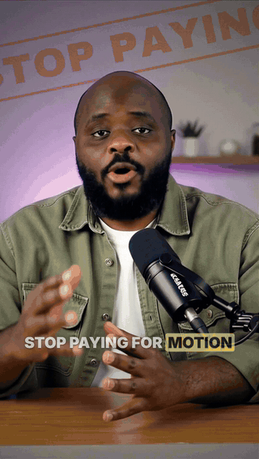

# awa-video-reel

A free, open-source Claude Code skill by Awa K. Penn that edits your short videos so every visual and sound lands on the words you say. MIT licence.

**[Download awa-video-reel.zip](https://github.com/Awa67572/awa-video-reel/releases/latest/download/awa-video-reel.zip)**

New to this? Follow the [step-by-step guide (PDF)](awa-video-reel-step-by-step.pdf).

The full source code is in the [`awa-video-reel`](awa-video-reel) folder on this page, so you can read every file before you install anything. The zip is that same folder.

## What it does

Drop in a video (up to 1 minute) and type `/awa-video-reel`. It adds:

- face-tracked effects (stamps, toggles, phone fans, checklists and more)
- captions with your keywords highlighted, plus title, stat, list and call-to-action cards
- punch-ins, a slow push and an optional cinematic look
- music that dips under your voice, and a sound on every change
- website b-roll: mention a site and it asks if you want it recorded, then opens it in Chrome and scrolls and clicks with a visible cursor
- the follow-through: copy a prompt on the site, paste it into a real Claude Code window with your details typed in, then the result playing
- an optional "Follow for more" card with your handle

It shows you the plan first and renders only after you say yes. You get two MP4s: one with music, one without.

## What's in the code

| Folder | What it is |
|---|---|
| [`SKILL.md`](awa-video-reel/SKILL.md) | The instructions Claude follows, step by step |
| [`scripts/`](awa-video-reel/scripts) | The editing pipeline: `setup.sh` (first-run install), `prepare.sh` (checks and transcribes your video), `broll.py` (b-roll), `hf_build.py` (captions, cards and layout), `mix.py` (music and sound), `render.sh` (puts it all together) |
| [`recorder/`](awa-video-reel/recorder) | `record.mjs` records a website in your Chrome. `claude_session.mjs` and `render_cast.mjs` record and replay the Claude Code window |
| [`remotion/`](awa-video-reel/remotion) | The intro and "Follow for more" cards |
| [`effects/`](awa-video-reel/effects) | The face-tracked effects engine (MIT licence in [`effects/LICENSE`](awa-video-reel/effects/LICENSE)) |
| [`music/`](awa-video-reel/music) and [`sfx/`](awa-video-reel/sfx) | Free music and sound effects, with their credits |

**What it does on your computer:**
- Your video is transcribed and edited on your own machine, with ffmpeg, Python, HyperFrames and Remotion.
- The first run installs its tools from PyPI and npm: numpy, OpenCV, Pillow, MediaPipe and faster-whisper; Puppeteer, xterm.js and Remotion. You can see the lists in [`effects/requirements.txt`](awa-video-reel/effects/requirements.txt), [`recorder/package.json`](awa-video-reel/recorder/package.json) and [`remotion/package.json`](awa-video-reel/remotion/package.json).
- Website b-roll opens sites as a logged-out visitor. It never signs in, buys or submits anything.
- The Claude Code b-roll only pastes, types and presses Enter. It never approves anything, so nothing runs.

## Install (3 steps)

1. Download and unzip `awa-video-reel.zip`.
2. Copy the `awa-video-reel` folder into `~/.claude/skills/`.
3. Restart Claude Code, drag in a video and type `/awa-video-reel`.

Or open Claude Code and paste: "Install the skill in this folder: [path to the unzipped folder]. Follow its INSTALL.md."

**Prefer to take it straight from the source?** Click **Code → Download ZIP** on this page (or run `git clone https://github.com/Awa67572/awa-video-reel`), then copy the `awa-video-reel` folder inside it into `~/.claude/skills/`.

You also need Google Chrome (or Edge), Node.js 20+, Python 3.11 or 3.12 and ffmpeg. The full list and tips are in [`INSTALL.md`](awa-video-reel/INSTALL.md).

## Licence

awa-video-reel is open source under the [MIT licence](LICENSE): use it, change it and share it, free, including for commercial work. Keep the licence notice with any copy.

The bundled parts keep their own licences: the effects engine is MIT too ([`effects/LICENSE`](awa-video-reel/effects/LICENSE)), the music and sound effects are listed with their licences in their `CREDITS.md` files, and each font has its licence file next to it.

## Credits

Effects engine: MIT licence ([`effects/LICENSE`](awa-video-reel/effects/LICENSE)). Captions, cards and b-roll layout: HyperFrames by HeyGen. Cards: Remotion. Sound effects: Pixabay ([`sfx/CREDITS.md`](awa-video-reel/sfx/CREDITS.md)). Music: CC0 and one CC BY track ([`music/CREDITS.md`](awa-video-reel/music/CREDITS.md)). Fonts: each with its own licence file next to it.

Learn AI for free in my newsletter: [awa-newsletter.beehiiv.com/subscribe](https://awa-newsletter.beehiiv.com/subscribe)
